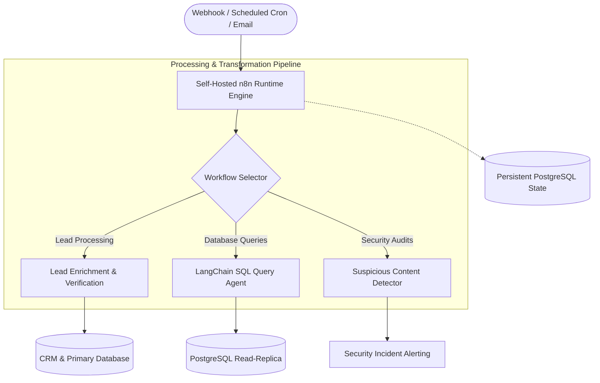

# Enterprise n8n Workflow Automation Blueprints

[](https://n8n.io/)
[](docker-compose.yml)
[](https://www.postgresql.org/)
[](LICENSE)

A production-grade collection of containerized, self-hosted **n8n workflow blueprints** engineered for asynchronous data pipelines, LLM-orchestrated database agents, and multi-channel CRM lead processing.

[Architecture Flow](#orchestration-architecture) &bull; [Curated Blueprints](#curated-workflow-blueprints) &bull; [Quick Start](#quick-start-docker)

---

## System Objective: Why This System Exists

Enterprise systems constantly interact with diverse external protocols: incoming customer webhooks, email triggers, third-party CRM APIs, and generative AI models. Hardcoding every integration into primary monolith or microservice codebases results in brittle architectures, complex dependency graphs, and delayed release cycles.

This repository provides standardized, containerized reference workflows demonstrating:
1. **Decoupled Workflow Orchestration:** Complex multi-step business logic (e.g., lead validation, natural language SQL generation, anomaly detection) offloaded to a self-hosted automation engine.
2. **Data Sovereignty & Security:** Workflows execute within an isolated Docker environment backed by dedicated PostgreSQL storage, avoiding third-party iPaaS data leakage.
3. **Resilient Retry & Error Handling:** Error triggers, dead-letter routing, and structured JSON logging.

---

## Technical Stack Breakdown

- **Automation Engine:** n8n v1.x (Self-hosted node-based workflow automation runtime)
- **Database & State Store:** PostgreSQL 16 (Workflow definitions, execution histories, credential hashes)
- **Containerization:** Docker & Docker Compose (Multi-container orchestration)
- **Integrations:** OpenAI API, Claude API, PostgreSQL, LangChain nodes, Webhooks, REST APIs
- **Architecture Documentation:** Architecture Decision Records (ADRs) tracking design decisions

---

## Curated Workflow Blueprints

### 1. Autonomous Web Extraction & Data Normalization Pipeline
*Path: `workflows/01-autonomous-web-extraction-pipeline.json`*
- **Purpose:** Scheduled and webhook-triggered web scraping pipeline that extracts structured entities from target web resources.
- **Mechanics:** Executes headless fetching, cleans HTML artifacts, extracts metadata via regex/DOM parsers, and dispatches normalized JSON payloads to internal database ingestion endpoints.

### 2. Natural Language Database Query Agent (PostgreSQL + LangChain)
*Path: `workflows/02-database-natural-language-agent.json`*
- **Purpose:** Allows authorized technical operators to query database schemas using natural language prompts without manual SQL writing.
- **Mechanics:** Integrates LLM reasoning nodes with strict schema introspection, generates read-only parameterized SQL queries, executes queries against isolated PostgreSQL read-replicas, and returns structured data tables.

### 3. Lead Qualification & CRM Routing Engine
*Path: `workflows/03-lead-qualification-and-crm-routing.json`*
- **Purpose:** Automates multi-stage inbound lead processing, email validation, and CRM pipeline assignment.
- **Mechanics:** Evaluates incoming prospect responses, runs automated email syntax and domain MX-record verification, categorizes intent via LLM classification, and routes qualified leads directly to CRM databases while triggering automated follow-up sequences.

### 4. Security Policy & Suspicious Content Detector
*Path: `workflows/04-security-suspicious-content-detector.json`*
- **Purpose:** Automated webhook pipeline inspecting incoming communication payloads for malicious links, suspicious attachments, and phishing patterns.
- **Mechanics:** Parses MIME email structures, evaluates URLs against domain safety heuristics, analyzes text sentiment via LLM safety prompts, and routes security alerts to designated administrative incident channels.

---

## Orchestration Architecture



---

## Security & Operational Standards

- **Zero Hardcoded Credentials:** All API keys, tokens, and database passwords are parameterized through n8n environment variables and encrypted credential stores.
- **Read-Only Database Permissions:** Database query agents connect strictly via dedicated read-only credentials, preventing accidental `UPDATE` or `DELETE` executions.
- **Air-Gapped Data Processing:** Self-hosted deployment ensures no customer records or proprietary schemas leave the private server perimeter.

---

## Quick Start (Docker)

```bash
# 1. Clone repository
git clone https://github.com/ShahAhmar/enterprise-n8n-automation-blueprints.git
cd enterprise-n8n-automation-blueprints

# 2. Boot up n8n and PostgreSQL
docker compose up -d

# 3. Access web console
```
Open `http://localhost:5678` in your browser.

To import any blueprint:
1. Navigate to **Workflows** in the n8n sidebar.
2. Click **Import from File**.
3. Select any `.json` file from the `workflows/` directory.

---

## Author

**Syed Ahmar Ali**  
*Senior Full-Stack Engineer & Solutions Architect*  
- Portfolio: [ahmar.techgitsolutions.com](https://ahmar.techgitsolutions.com)  
- GitHub: [@ShahAhmar](https://github.com/ShahAhmar)
